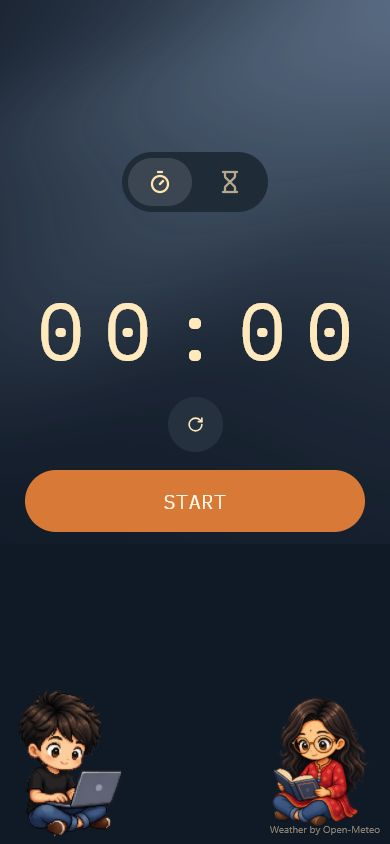
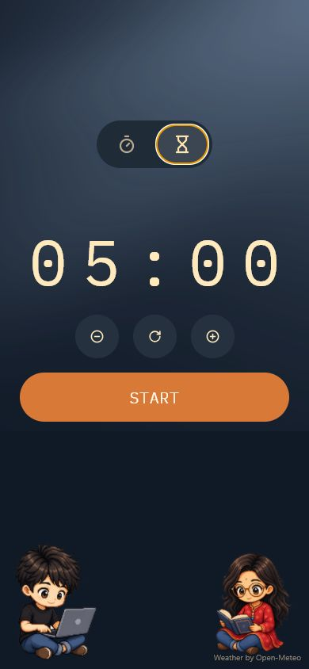

# Adwi Clock

> A tiny, weather-aware timer made with love for Adwi's study sessions.

| Stopwatch | Timer |
| --- | --- |
|  |  |

## The little story behind it

[Rubaiyat Tasnim Chowdhury](https://github.com/rubaiyattasnim) uses Pomodoro
sessions when she studies. Samsung's timer did the job, but it felt a little
too grey and serious for all those hours of focus. So she asked me to make her
a cute one.

And, well, when someone you care about asks for a cute timer, you make the
timer.

**Adwi** is short for **Adwitiya**, Rubaiyat's nickname. What began as a small
gift for her became a calm little clock with changing skies, tiny study
companions, soft motion, and just enough encouragement to make the next focus
session feel warmer.

I'm sharing the source because useful software can be personal too. Maybe it
helps someone learn Expo, inspires another small gift, or simply makes a study
desk feel a bit less lonely.

## What it does

- A clean stopwatch and an adjustable countdown timer
- Calm rolling-number transitions
- Tiny animated study companions
- Weather-aware colors and atmosphere
- A completion chime and vibration
- An optional location permission with a graceful time-of-day fallback
- Android, iOS, and web support through Expo

The timer starts at five minutes. Tap `+` or `−` to change it by one minute,
or hold either button to move in ten-minute steps.

## Run it locally

You will need a current Node.js LTS release.

```sh
# Clone or download this repository, then:
npm install
npm start
```

Then choose Android, iOS, or web from Expo's development menu.

Useful commands:

```sh
npm run android
npm run ios
npm run web
npm run check
```

The included `eas.json` has development, preview, and production build
profiles. `app.json` is linked to the original EAS project; if you fork the
app, run `npx eas init` to connect your own project before building with EAS.
The project ID is public configuration, not a credential.

## Weather and privacy

Adwi Clock asks for foreground location only to choose an ambient weather
theme. If you say no—or if the weather service is unavailable—the clock keeps
working and uses a time-of-day theme instead.

The app has no account, advertising, analytics, or project-operated server.
Coordinates are sent directly from the device to Open-Meteo. The full,
plain-language explanation is in [PRIVACY.md](./PRIVACY.md).

Weather data is provided by
[Open-Meteo.com](https://open-meteo.com/) under CC BY 4.0. The free endpoint
used by this project is for non-commercial use; commercial distributions
should use an appropriate Open-Meteo plan, self-host it, or replace the
provider.

## Come make it nicer

Small fixes, accessibility improvements, gentle animation refinements, and
thoughtful study features are welcome. Please read
[CONTRIBUTING.md](./CONTRIBUTING.md) before sending a pull request.

The code is organized around:

- `App.tsx` — stopwatch/timer state and the main screen
- `src/weather.tsx` — weather lookup, palettes, and atmosphere
- `src/components/ClockDisplay.tsx` — rolling digits and button labels
- `src/components/CharacterScene.tsx` — the little study-companion scenes
- `src/utils/time.ts` — pure time formatting helpers

## License and credits

The source code is released under the [MIT License](./LICENSE). The custom
artwork and sound are shared separately under CC BY-NC 4.0, so please read
[ASSETS.md](./ASSETS.md) before reusing them.

Built by Ananyo Shourjo, for Adwi. ❤️
